<!-- Exported from the Claude Doc 'Palette & Gradient Studio: Specification' (v0.3, 17 Nov 2026). This file is the source of truth for development; change it through pull requests. -->

# Palette & Gradient Studio: Product and Technical Specification

*Draft v0.3 (image views, project library and Materials tab added) · 17 November 2026 · A client-side design tool for GitHub Pages*

## 1. Purpose, scope and principles

A single-page tool that runs entirely in the browser. You load an image, extract a color palette with a choice of algorithms and settings, edit that palette, generate gradients from it, and export the palette and the gradient separately. Part 1 (sections 1 to 11) covers that; Part 2 (sections 12 to 21) maps the palette to real paints from brand catalogues.

**Decisions at a glance**

| Area | Decision | See |
| --- | --- | --- |
| Hosting and license | Static site on GitHub Pages, public repository, MIT | 7.8, 7.10 |
| Stack | Vite, TypeScript, Preact with signals | 7.1 |
| Color | sRGB output; OKLab and OKLCH for extraction, editing and interpolation | 2.3, 7.9 |
| Devices and themes | Desktop and phones (iPhone first-class), light and dark | 6.1, 6.2 |
| Export targets | Affinity first, then Figma, Adobe and image files | 5.4 |
| Images | One image per project, never uploaded | 1, 5.3 |
| Paint mediums | Spray paint, acrylic wall paint, studio acrylic, oil; watercolor later | 13.2 |
| Still open | Product name, catalogue brands, Lab data, mix suggestions | 10, 20 |

**Goals**

- Controllable palette extraction with several algorithms, because no single algorithm suits every image.
- Direct control over where colors come from: draggable sample points on the image (3.7).
- Perceptual editing and interpolation (OKLab and OKLCH) so adjustments behave predictably.
- Gradients that go beyond two color pickers: several types, stop-sourcing techniques, interpolation spaces and easing.
- Exports that drop straight into Affinity first, then Figma, Adobe, GIMP, CSS, Tailwind and design-token workflows.
- Matching the palette to real spray, wall, acrylic and oil paints (Part 2).
- Comfortable on a phone as well as a desktop, in light and dark themes.
- No backend: images never leave the browser, and the app is plain static files.

**Non-goals for v1:** accounts or cloud sync, server-side processing, video, generative AI features, batch folders, several images per project (one image at a time), general image editing.

**Principles:** everything local; deterministic output (same image + settings + seed = same palette); live preview with no Apply buttons; the palette is the single source of truth for gradients; every result is reproducible from a saved project or share link.

## 2. Palette extraction: methods and findings

### 2.1 Pipeline

1. Decode and orient the image (honor EXIF rotation).
2. Downscale or sample. This alone makes extraction fast enough to run live.
3. Filter pixels: transparent, near-black, near-white, low-chroma, or outside the region of interest.
4. Convert to the working color space.
5. Bin into a weighted histogram.
6. Quantize or cluster to N colors.
7. Post-process: merge near-duplicates, sort, label, compute population share.

Steps 2 to 4 shape the result as much as the algorithm does, so they are exposed as settings.

### 2.2 Algorithms

| Algorithm | How it works | Strengths | Weaknesses | v1 |
| --- | --- | --- | --- | --- |
| Median cut (Heckbert 1982; the MMCQ variant is what Color Thief uses) | Recursively splits the color box along its widest channel at the median, so each box holds similar pixel counts; box averages become the palette | Very fast, deterministic, good dominant colors | Axis-aligned splits; small accent colors get swallowed | Yes. Used by the Dominant preset |
| Octree (Gervautz & Purgathofer 1988) | Inserts colors into an 8-way tree by bit level, then merges the least-populated leaves until N remain | Single pass, preserves extremes and highlights | Can latch onto JPEG-artifact highlights; less balanced | Optional (v2) |
| Wu (1992) | Builds a 3D histogram with cumulative moments and picks cuts that minimize variance | Deterministic, low error for small palettes, fast | More code to write | Yes. Used to seed k-means |
| K-means / k-means++ | Assigns pixels to the nearest centroid and re-averages, repeated; k-means++ gives well-spread starting points | Most perceptually balanced palettes when run in OKLab/Lab; centroids can be true mid-tones | Iterative and slower; needs a seed to be repeatable | Yes. Quality mode |
| Balanced: Wu seed + weighted k-means refinement + scoring | The approach behind Google’s Material Color Utilities: quantize, refine, then rank by population and chroma | Robust for UI-theme style palettes | Scoring favors chromatic colors and can hide neutrals | Yes. Default |
| Exact colors (popularity) | Counts exact or lightly binned colors and takes the top N | Preserves the real colors of logos, flat art, pixel art | Useless on photos, where thousands of near-identical colors compete | Yes |
| Swatch roles (Vibrant style) | Picks six named swatches (Vibrant, Muted, Dark/Light variants) by target lightness and saturation windows | Gives labeled, UI-ready colors | Not a full palette; some roles can come back empty | Yes |
| Even spread (farthest-point) | Repeatedly picks the color farthest from those already chosen | Surfaces distinct accents | Over-represents noise and outliers | Yes |

Practical finding: k-means is usually reported as the best-balanced result but costs an order of magnitude or more in runtime than median cut or octree. In the browser the fix is to run every algorithm on a binned, weighted histogram (at most 32,768 bins at 5 bits per channel) instead of raw pixels, which keeps even k-means interactive.

### 2.3 Working color space

RGB distances don’t track perceived difference, so clustering in raw sRGB gives uneven results. CIELAB is better. OKLab (Ottosson, 2020) is simpler, behaves better across blues, and is native in CSS, so one set of math can drive extraction, editing and gradients. Default to OKLab, with CIELAB, linear sRGB and gamma sRGB available for comparison.

Color distance (ΔE) is needed for merging and ordering. Offer ΔE in OKLab (Euclidean; a difference of roughly 0.02 is about a just-noticeable step) and CIEDE2000 (more accurate, slower).

### 2.4 Extraction settings

| Setting | Options / range | Default | Notes |
| --- | --- | --- | --- |
| Algorithm | Median cut, Wu, K-means++, Balanced, Exact colors, Even spread, Swatch roles | Balanced | Octree added later |
| Number of colors | 2 to 32 | 6 | Slider plus number field |
| Working space | OKLab, CIELAB, linear sRGB, sRGB | OKLab |  |
| Sample size (longest edge) | 64, 128, 256, 512, full | 256 | Smaller is faster, noisier |
| Resampling | Smooth (area average) or Nearest | Smooth | Nearest keeps exact colors for pixel art and flat art; smoothing invents in-between colors at hard edges |
| Alpha cutoff | 0 to 255 | 128 | Ignore pixels more transparent than this |
| Ignore dark / light | Lightness thresholds, off by default | Off | Skips black or white backgrounds and vignettes |
| Ignore background | Off or auto-detect from border pixels | Off | Removes studio backdrops |
| Minimum chroma | 0 to 0.2 (OKLab C) | 0 | Drops grayish pixels from consideration |
| Population vs. vividness | 0 to 1 | 0 | 0 ranks by pixel share; higher favors saturated colors |
| Merge threshold | ΔE 0 to 0.15 | 0.03 | Merges near-duplicate swatches (population-weighted) |
| Distance metric | ΔE OK or CIEDE2000 | ΔE OK |  |
| Spatial weighting | Uniform, center-weighted, edge/contrast-weighted | Uniform | Center and contrast weighting approximate where the eye goes |
| Region of interest | Rectangle or ellipse drawn on the image | Whole image | Extract from a crop without re-uploading |
| Keep one outlier | On or off | Off | Reserves a slot for the most distinct small cluster |
| Histogram bits per channel | 4, 5, 6 (advanced) | 5 |  |
| K-means iterations / restarts | 5 to 100 / 1 to 10 | 25 / 3 | Best of the restarts is kept |
| Seed | Integer plus a Randomize button | 1 | Makes k-means and random ordering repeatable |
| Sort | Population, lightness, chroma, hue, as extracted | Population |  |

### 2.5 Presets

- **Dominant:** median cut, 6 colors, merge 0.03.
- **Balanced (default):** Wu seed + k-means, 6 colors.
- **Vibrant:** k-means, vividness 0.6, ignore near-black and near-white.
- **Flat art:** exact colors, nearest resampling, no merge.
- **Accents:** even spread with one outlier kept.
- **Swatch roles:** six labeled swatches.

### 2.6 Cluster map

Hovering a swatch highlights the pixels that contributed to it as an overlay on the image and shows its population share, so you can judge whether extraction found what you actually see.

## 3. Palette editing

### 3.1 Swatch model

Each swatch stores its color (as OKLCH plus alpha), a lock flag, a name, its origin (extracted, picked or manual), its population share and its image point (see 3.7).

### 3.2 Per-swatch actions

- Edit with HEX, RGB, HSL and OKLCH (L, C, H as sliders and number fields), with an out-of-gamut indicator.
- Eyedropper: click or tap the image to add a swatch there, or to retarget the selected one. It creates a sample point (3.7) with the same loupe and sampling radius, and works on every device because it doesn’t rely on the browser EyeDropper API.
- Lock, duplicate, delete, add, drag to reorder, copy value, rename (suggests the nearest CSS color name).
- Generate a ramp from the swatch (see 3.4).

### 3.3 Global adjustments

Adjustments apply to unlocked swatches and are stored as parameters on top of the extracted base, so they are non-destructive and resettable.

| Adjustment | Effect |
| --- | --- |
| Lightness | Shift OKLab L up or down |
| Chroma | Scale saturation (OKLCH C) |
| Hue rotate | Shift OKLCH hue by degrees |
| Contrast | Expand or compress lightness around the middle |
| Temperature / tint | Shift along the blue-yellow / green-magenta axes (OKLab b / a) |
| Gamma | Bend the lightness curve |
| Lightness range | Clamp min and max L |
| Even out lightness | Space swatch lightness in equal steps |
| Harmonize | Pull hues toward a chosen anchor hue by a percentage |
| Gamut | Clamp to sRGB by reducing chroma (keeps hue and lightness) |

### 3.4 Ramps and harmonies

- **Ramps:** from any swatch, generate a tonal scale (for example 11 steps, 50 to 950) on an OKLCH lightness curve with chroma tapering at the extremes.
- **Harmonies:** from a selected swatch, propose complementary, split-complementary, triadic, tetradic and analogous colors; add the ones you like to the palette.

### 3.5 Analysis and accessibility

- Contrast matrix with WCAG 2.x ratios and AA/AAA badges (APCA as an optional extra).
- Color-vision-deficiency simulation (protanopia, deuteranopia, tritanopia, achromatopsia) applied to the palette and to gradients.
- Warnings when two swatches are closer than the merge threshold.
- Gamut indicator for sRGB; a Display-P3 boundary can come later (7.9).

### 3.6 History

Undo and redo (50 steps) cover the palette, adjustments, sample points and gradients. View state (zoom, selection, open panel, theme) isn’t recorded, so undo never jumps the view around. Also: reset to extracted, a before/after compare toggle, and re-extraction that preserves locked swatches.

### 3.7 Sample points on the source image

Each extracted swatch gets a marker on the source image showing where its color lives. Dragging a marker re-samples the image at the new spot and updates the swatch color live.

**Marker placement (at extraction)**

- Extraction algorithms return averages, not pixel positions, so each swatch needs a representative location. For every swatch, build a mask of the pixels assigned to it at sample resolution, blur it (radius about 3% of the shorter image side), and take the pixel with the highest blurred density, breaking ties by the smallest ΔE to the swatch color. This puts the marker on a coherent patch of that color, not on an edge or a noisy pixel.
- Positions are stored as normalized coordinates (0 to 1), so they survive resizing and zoom.

**Marker appearance**

- A ring with a white outer and dark inner stroke (visible on any background), filled with the swatch color, with the swatch number beside it. It keeps the same on-screen size at any zoom.
- Hovering or selecting a marker highlights its swatch card, and the reverse. Overlapping markers fan out their labels; the selected marker sits on top.
- A toggle shows or hides all markers. The cluster-map overlay (2.6) can run at the same time.

**Dragging**

- Pointer events cover mouse, touch and pen. A loupe (about 8× zoom, crosshair, live HEX) follows the pointer and sits above the finger on touch.
- The color is sampled from the working master (the image at up to 4096 px, see 7.4), not the small analysis copy; only a small crop is drawn into a tiny canvas, so no full-size canvas is needed, as the mean (or the median, for noisy images) over a small patch. Radius: Auto (0.5% of the shorter side, minimum 2 px), or 1, 3, 5 or 11 px.
- Updates run once per animation frame. During the drag the swatch, gradient preview and contrast matrix update live; paint matching (Part 2) and other heavy work wait until release.
- Keyboard: Tab to a marker, arrow keys nudge 1 px, Shift+arrow 10 px, Esc cancels a drag. Each marker has a label for screen readers (swatch number, position) and announces its new HEX.
- A completed drag is one undo step that restores both position and color.

**What a moved point does to the swatch**

- The swatch becomes picked (origin = picked) and pinned (locked), so re-extraction keeps it and its point. Unlocked swatches get fresh points on re-extraction.
- Reset to extracted (a button in the swatch editor) restores the original color and position, and the editor shows the ΔE between the extracted and picked colors.
- Global adjustments (3.3) apply on top of the picked color. The marker ring shows the color found in the image; the palette swatch shows the adjusted result.
- Dragging outside the region of interest is allowed; the region only affects extraction.

**Edge cases**

- Manual swatches (typed colors) have no marker; Place on image drops one at the best-matching spot, using the same placement method as above.
- Reloading a saved project without its image hides the markers. Loading a different image than the one saved (name or pixel size differs) shows a warning, and Re-extract places new markers.
- The Image sample gradient technique (4.2) can take its stops from the markers, ordered by x, by y, or along a drawn path.

**Acceptance**

1. Every extracted swatch shows a marker, and hover links marker and swatch both ways.
2. Dragging a marker updates its swatch color live, and the sampled color matches the pixel patch under the marker.
3. A moved swatch is locked and survives re-extraction; undo restores both position and color.
4. Dragging works with mouse, touch and keyboard.

### 3.8 Image views: palette preview, value study and transfer grid

The source image can be shown three ways, plus a grid overlay that works with any of them. All of it adds a single control row: a view bar under the image. Each view’s options replace the setting rows below the image instead of adding new ones (see 6.6).

| View | What it shows | Options shown in the rows under the image |
| --- | --- | --- |
| Image (default) | The photo with its sample points (3.7) | Extraction settings: Algorithm, Colors, Working space |
| Palette | The image redrawn using only palette colors: each pixel takes its nearest swatch in OKLab. A bar shows each color’s share of the image area | Colors from (Palette, or Matched paints from Part 2); Dither (off by default) |
| Values | The image in grayscale by OKLab lightness, either continuous or in 3 or 5 bands; swatch pairs that are too close in value are listed | Bands (continuous, 3 or 5; default 5); Close in value (the flagged pairs) |

**Palette view**

- It answers “does this palette really cover the image?” at a glance. A missing color, such as a neutral background that gets painted green, shows up immediately.
- It uses the current palette after adjustments (3.3), so it updates live as swatches change. With Matched paints, it uses each swatch’s chosen paint (14.5), showing the image as it would look painted.
- Area shares are fractions of the whole image and are shown on the bar and in each swatch’s details. They are the basis for the future quantity estimator (14.7).
- Dither (Floyd–Steinberg, error diffusion in OKLab) is optional; it shows how colors mix optically, but the default flat view is clearer for planning.

**Values view**

- Painters plan with values (lightness) before hue. The banded view shows the light-to-dark structure the palette will produce. Bands split OKLab lightness into equal steps, and each band shows as the gray at its middle (with 5 bands: L 0.1, 0.3, 0.5, 0.7 and 0.9).
- A pair of swatches whose OKLab lightness differs by less than 0.03 (adjustable 0.01 to 0.10) is listed under Close in value, and the pair is marked on the swatch strip. Such colors merge in grayscale and can lose contrast in the finished piece.

**Transfer grid**

- A toggle beside the view bar overlays a square grid for scaling the design onto a wall or canvas with the grid method. It works over the Image, Palette or Values view. While it is on, the rows under the image show the grid’s options instead of the view’s, and turning it off brings the view’s options back.
- Options: squares across (2 to 24, default 6, rows follow from the aspect ratio), and labels (letters across the top, numbers down the side). Lines switch between dark and light automatically so they stay visible, and line weight stays constant on screen at any zoom.
- Export grid: a PNG at a chosen size, or a printable PDF (A4 or Letter, fitted to the page) of the current view with the grid and labels.

**Behavior**

- Sample points (3.7) show only in the Image view with the grid off; the other views and the grid hide them so the image reads clearly.
- Views are computed in the extraction worker from the working master (7.4), downscaled to display size, and cached per view; switching views never re-runs extraction. During a marker drag, the Palette and Values views update once on release.
- The chosen view, bands and grid settings are saved with the project, not in share links.

**Acceptance**

1. Switching between Image, Palette and Values, and toggling the grid, never re-runs extraction and takes under 100 ms on a cached view.
2. Every pixel in the Palette view (with dither off) equals one palette color, and the area shares add up to 100%.
3. With 5 bands, the Values view shows exactly 5 grays, and pairs closer than the threshold are listed and marked.
4. The grid has square cells and correct labels, stays visible on light and dark images, and exports as PNG and a one-page PDF.

## 4. Gradient generation

### 4.1 Gradient types

- **Linear** (angle or direction).
- **Radial** (circle or ellipse, size keywords, position).
- **Conic** (start angle, position).
- **Repeating** linear, radial and conic.
- **Stepped / banded** (hard stops).
- **Easing** (smoothed stops that approximate an easing curve).
- **Mesh-style** (several color points blended across the canvas). Exact in raster export; the CSS version is an approximation built from stacked radial gradients and is labeled as such.

### 4.2 Stop-sourcing techniques

| Technique | What it does |
| --- | --- |
| Palette order | Uses swatches as they appear |
| Sorted | By lightness (dark to light), hue around the wheel, or chroma |
| Smooth path | Reorders swatches to minimize total ΔE between neighbors (nearest neighbor plus 2-opt) so transitions feel even |
| Subset | Pick 2 to N swatches by hand, or auto-pick the N most distinct |
| Image sample | Draw a line (or horizontal, vertical, radial scan) across the image and sample N points, so the gradient follows the photo’s own color flow |
| Derived | From one swatch, build analogous (about ±30° hue), complementary, monochrome (lightness ladder) or warm-to-cool gradients |
| Constrained random | Seeded shuffle with minimum ΔE and contrast constraints; Shuffle button |
| Population-weighted | Stop positions proportional to each swatch’s share of the image |

### 4.3 Interpolation settings

- **Color space:** sRGB, linear sRGB, Display-P3, Lab, OKLab (default), LCH, OKLCH, HSL, HWB, XYZ. Why it matters: blending complementary colors in sRGB tends to pass through a dull gray, while OKLab and OKLCH keep lightness smooth and colors saturated. OKLCH can sweep through unexpected hues, so OKLab and OKLCH are both offered with a side-by-side compare mode.
- **Hue method** (polar spaces only): shorter, longer, increasing, decreasing.
- **Premultiplied alpha** when stops have transparency.
- **Stops:** click the bar to add, drag to move, set position as a percentage or length, per-stop alpha, per-stop lock, and a draggable midpoint hint between stops. Stops reference swatches by id, so palette edits flow into the gradient. Typing a color into a stop detaches it (an unlink icon shows, with Relink), and deleting a swatch turns its stops into fixed colors.
- **Easing between stops:** linear, ease-in, ease-out, ease-in-out, smoothstep or custom cubic-bezier, implemented by inserting 8 to 32 intermediate stops per segment so the output stays a plain gradient.
- **Gamut handling:** clamp or chroma-reduce interpolated colors that fall outside sRGB.
- **Geometry:** angle with dial and presets, center position, shape and size, repeat length, reverse, mirror (palindrome).
- **Mesh:** 2×2 to 5×5 grid or free points, each assigned a palette color; blended in OKLab with Gaussian weights; blur radius and grain controls.
- **Banding control:** optional dither or grain in raster export, since 8-bit gradients band visibly in smooth dark areas.

### 4.4 Preview

Aspect ratios (free, 1:1, 16:9, 9:16, 4:3, banner, custom px), a compare mode for two interpolation spaces, a text-overlay check with contrast ratio, CVD preview, and a checkerboard for alpha.

### 4.5 Rendering strategy and browser support

Preview and export must agree, so there are three render paths:

1. **Live preview: native CSS gradient** with an explicit `in <space>` clause, GPU-accelerated. Gradient color-space interpolation is now widely available (Baseline since mid-2024; Chrome and Edge 111, Safari 16.2 to 16.4, Firefox 127, depending on the source). Feature-detect with `CSS.supports`.
2. **Baked stops:** the tool samples 16 to 64 points through the chosen interpolation, gamut-maps them and outputs plain sRGB stops. This renders identically in every browser and in tools that ignore interpolation hints.
3. **Raster renderer:** a custom per-pixel renderer (Canvas 2D in a worker, WebGL later) so PNG and WebP output matches the chosen color space and supports conic, mesh and grain.

SVG has no conic gradient and no choice of interpolation space, so SVG export uses baked stops and linear or radial types only.

## 5. Export: palette and gradient separately

Palette and gradient have independent export panels. Both operate on the current state and can export a selection or everything. Exported numbers always use a period as the decimal separator and a fixed precision, whatever the browser locale, so files parse the same everywhere.

### 5.1 Palette exports

| Format | Contents | Notes |
| --- | --- | --- |
| Text | HEX, RGB, HSL or OKLCH lists (comma, space or newline separated) | One-click copy |
| CSS custom properties | One variable per swatch, optionally with ramps | Value format selectable: hex, rgb, hsl, oklch, display-p3 |
| SCSS / Less | Variables and a map |  |
| Tailwind | v3 `theme.extend.colors` snippet and v4 `@theme` block |  |
| JSON | Simple array, and a design-tokens version | The W3C Design Tokens format has been evolving; check the current revision for the color value shape before finalizing |
| GIMP palette (.gpl) | Text palette | Opens in GIMP, Krita, Inkscape |
| Adobe Swatch Exchange (.ase) | Binary file written with DataView, RGB float values | Opens in Affinity, Illustrator, Photoshop, InDesign |
| SVG swatch sheet | Colored rectangles with labels | Pastes into Figma |
| PNG swatch strip | Optional hex labels, configurable size |  |
| Share link | State encoded in the URL hash | Palette and settings only, never the image |

Later: Procreate `.swatches`, Photoshop `.aco`, Sketch palette.

Options: include names, include population, sort order, decimal precision.

### 5.2 Gradient exports

| Format | Notes |
| --- | --- |
| CSS | `background-image` declaration with a modern `in oklch` line plus a baked-sRGB fallback line; also as a custom property |
| Tailwind | Arbitrary value or a `@utility` / config entry |
| SVG | Linear and radial, baked stops, chosen viewBox |
| PNG / WebP / JPEG | Chosen pixel size (cap around 8192 px on desktop and 4096 px on phones, tested at runtime), optional grain or dither, sRGB |
| JSON | Full definition (type, geometry, interpolation, stops in OKLCH and HEX), re-importable |
| Clipboard | CSS text, SVG text, or the image as PNG |

Example CSS output:

```css
.hero {
  background-color: #3a6ea5;
  /* baked sRGB fallback */
  background-image: linear-gradient(135deg, #3a6ea5, #6f8fa0, #b99a7a, #f4b863);
  /* modern; browsers that do not understand it ignore this line */
  background-image: linear-gradient(135deg in oklch, oklch(0.55 0.1 255), oklch(0.82 0.12 75));
}
```

### 5.3 Project file

Save and load a project as a `.palette.json` file holding extraction settings, palette, adjustments, sample points and gradients, but never the image.

- **Versioning:** every file carries a `schemaVersion`. Loading migrates older files step by step and refuses newer ones with a clear message instead of guessing.
- **Autosave:** every project in the library (5.5) autosaves to IndexedDB (not localStorage, which is small and blocks the page), including its working image, so a reload restores everything on the same device. A Clear local data control in settings removes it.
- **Share links:** the state without the image is compressed with the browser’s CompressionStream and base64url-encoded into the URL hash, which never reaches the server. If a link grows very long, the app suggests a project file instead.

### 5.4 Target tools: Affinity first, then Figma, Adobe and images

Export priority is Affinity, then Figma, then Adobe, plus image export. Each target gets a preset in the palette and gradient export panels that picks the right format and settings.

| Target | Palette | Gradient |
| --- | --- | --- |
| Affinity (1st) | `.ase` file. Affinity imports ASE and its own `.afpalette` from the Swatches panel (Panel Preferences, Import Palette). A native `.afpalette` writer is optional and later | SVG with baked stops (linear, radial) for editable vector fills; conical and mesh-style go out as PNG plus a stop sheet |
| Figma (2nd) | Figma has no palette-file import. Paste or drop the SVG swatch sheet for shapes, and use a community plugin such as Palette Importer (reads `.ase`, `.css`, `.json`) to create color styles | SVG with baked stops (linear, radial) pasted or dropped; conic and mesh-style as PNG plus a stop sheet |
| Adobe (3rd) | `.ase` for Illustrator, Photoshop and InDesign; `.aco` for Photoshop swatches as a later add | SVG opens in Illustrator with linear and radial gradients; Photoshop gradient presets (`.grd`) later; otherwise PNG plus a stop sheet |

Test each import path in the app versions you use before release, since import behavior differs between versions.

**Stop sheet (all targets):** a copyable text block for any gradient with its type, angle or position, and the position plus HEX and RGB of every stop, so it can be rebuilt in any gradient editor. It covers conical gradients, which SVG can’t express.

**Image export (palette, gradient or both):**

- Formats: PNG (default, lossless), JPEG with a quality slider, WebP; SVG where the gradient type allows.
- Size: presets (1080 square, 1920×1080, 3840×2160), custom pixels, 1×, 2× or 3× scale, capped at about 8192 px (4096 px on phones unless a runtime test allows more).
- Palette image: strip, grid or stacked bars, optional labels (HEX, name, paint code), solid or transparent background.
- Gradient image: every type including conic and mesh-style, with optional grain or dither.
- Combined board: one image with the source thumbnail, the palette swatches with codes and the gradient, for moodboards and handoff.
- Download, or copy to the clipboard as PNG. Pixels are sRGB; no ICC profile is embedded in v1.

Sources: [Affinity help, importing add-ons](https://affinity.help/publisher2/en-US.lproj/pages/Addons/importingAddons.html); [Palette Importer plugin](https://figma-web.pages.dev/plugins/1067561134666722782).

### 5.5 Project library

All projects live in a library inside the browser, so you can keep many palettes and switch between them without managing files. Every project autosaves, which is why the header has no Save button.

- **Opening it:** the current project’s name sits in the header next to the app name. Clicking it opens the library: a drawer on desktop and a bottom sheet on phones.
- **Entries:** each project shows a thumbnail (its image with the palette strip below), its name and when it was last edited. The current project is highlighted. The list is sorted by last edit and has a search field.
- **Actions:** New project, Import file (a `.palette.json` project or an image), and per project Rename, Duplicate, Export file (5.3) and Delete. Deleting asks for confirmation and can be undone from a toast for a few seconds.
- **Storage:** projects and their working images live in IndexedDB (7.4). The app asks the browser for persistent storage (`navigator.storage.persist`) to reduce the chance of eviction, shows how much space is used, and warns when it nears the browser’s limit.
- **Keeping a copy:** the library stays on this device and browser. A footer line says so, and Export file remains the way to back up a project or move it to another device; on iPhone the eviction warning in 6.1 applies.
- **First visit:** the library starts empty, and loading an image creates the first project, named after the image file.
- **Other entry points:** a share link (6.5) opens as an unsaved project with a Save to library button. The mockup state (`?demo=mockup`) never touches the library.

**Acceptance**

1. Creating, renaming, duplicating, exporting and deleting a project all work, and the library survives a reload.
2. Switching projects restores the image, palette, gradients, sample points and view settings exactly.
3. Deleting can be undone from the toast, and storage use is shown.

## 6. User interface

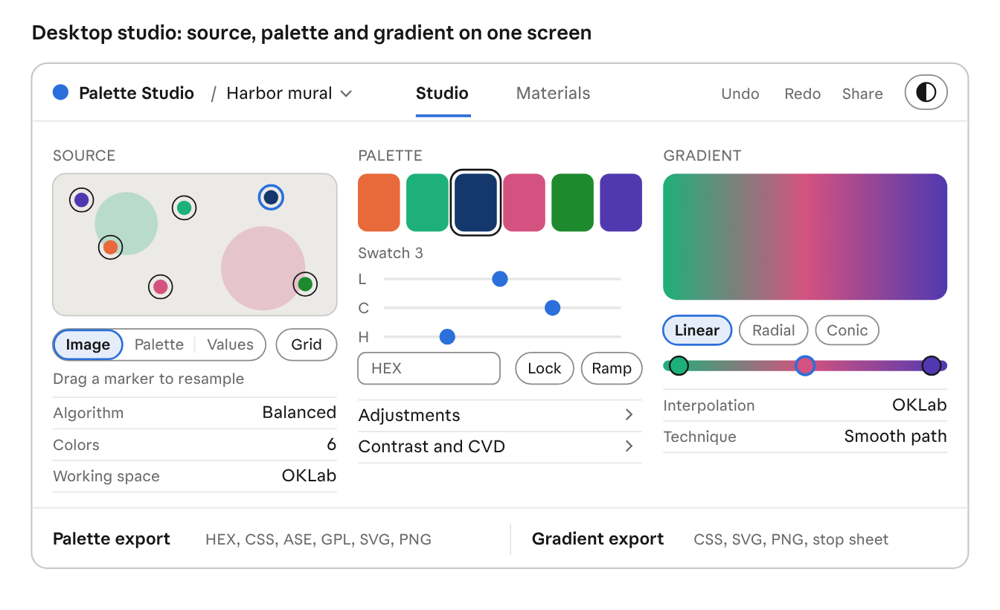

**Desktop, Studio view (light, then dark).** Source, palette and gradient sit side by side on one screen. The header holds the project name, which opens the library, plus Undo, Redo, Share and the theme button; there is no Save, because every project autosaves. The view bar under the image switches between the Image, Palette and Values views and turns the grid on. Palette and gradient exports stay separate in the drawer below.

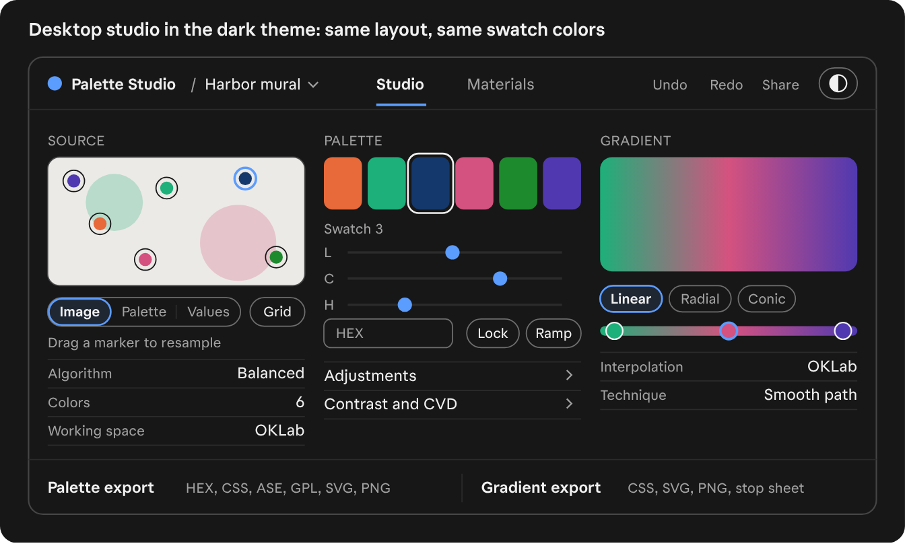

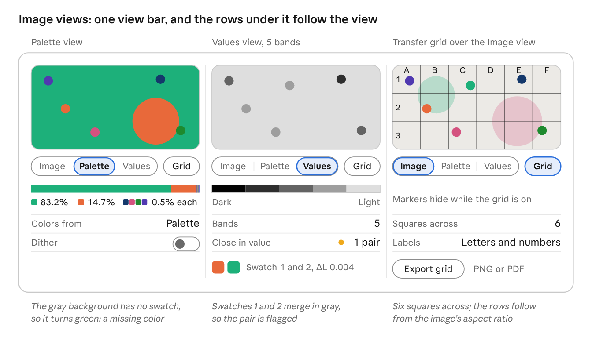

The image views (3.8) all use the same view bar, and each one swaps the rows under the image instead of adding a panel. On the mockup fixture, the Palette view shows the gray background turning green, the Values view flags the one pair of swatches that is close in value, and the grid hides the markers and shows its own options while it is on.

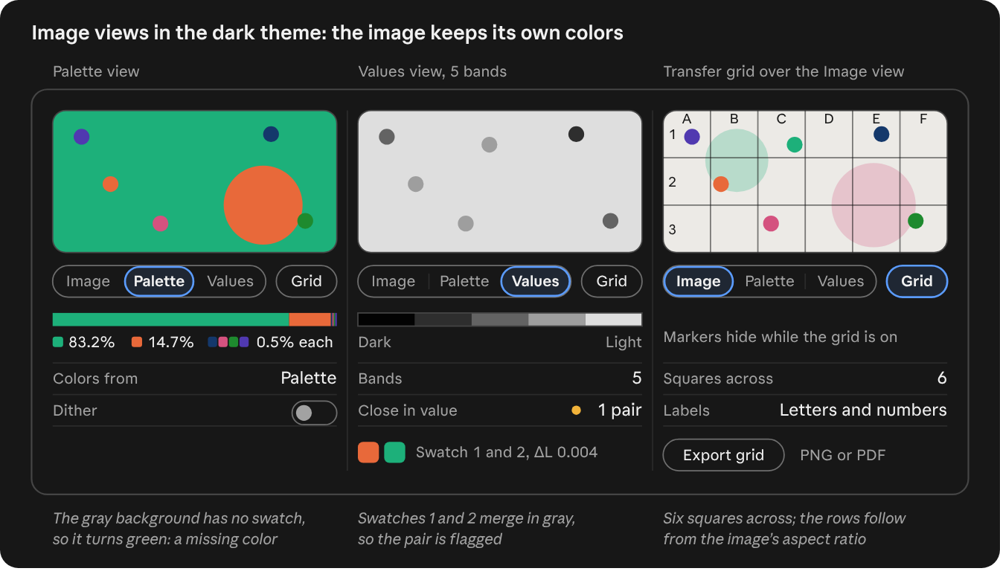

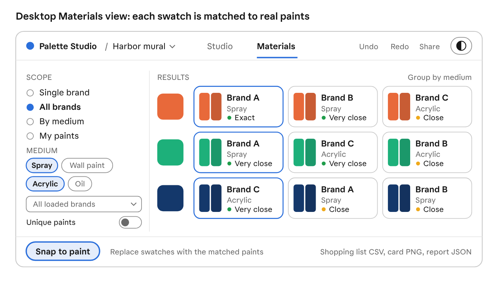

**Desktop, Materials view (light, then dark).** Part 2 gets its own tab. Filters on the left set the scope, each swatch shows its closest paints with a quality label, and Snap to paint applies the matches to the palette.

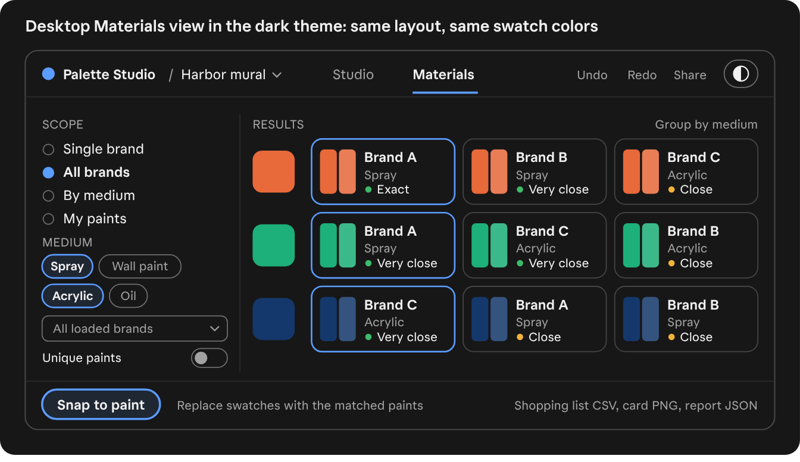

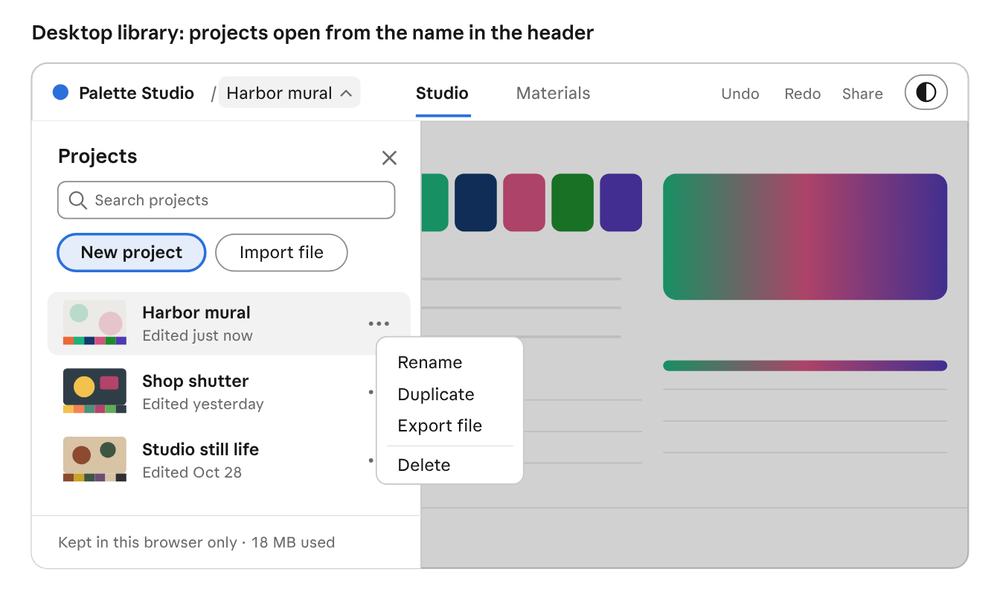

The project library (5.5) opens from the project name in the header as a drawer over the studio, so it adds no button of its own. The current project is highlighted, each project’s actions sit in its ⋯ menu, and the footer says the library lives in this browser and how much space it uses.

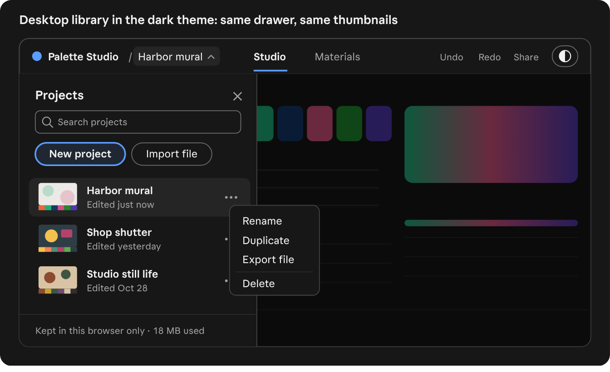

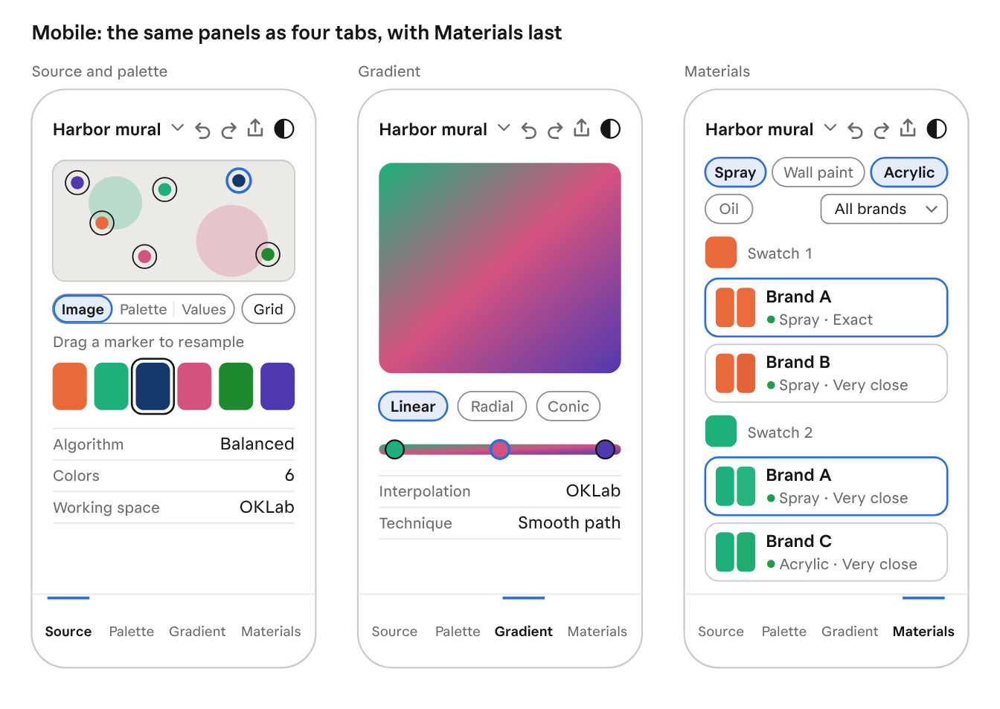

**Mobile (light, then dark).** The same panels become four tabs, with Materials last. The header shows the project name, which opens the library, with Undo, Redo, Share and the theme button as icons. The Materials tab shows all four medium chips, and each match carries its quality dot. Swatch colors in the mockups are placeholders and stay identical in both themes; brand names stand in until you supply catalogues. The button in the header switches theme.

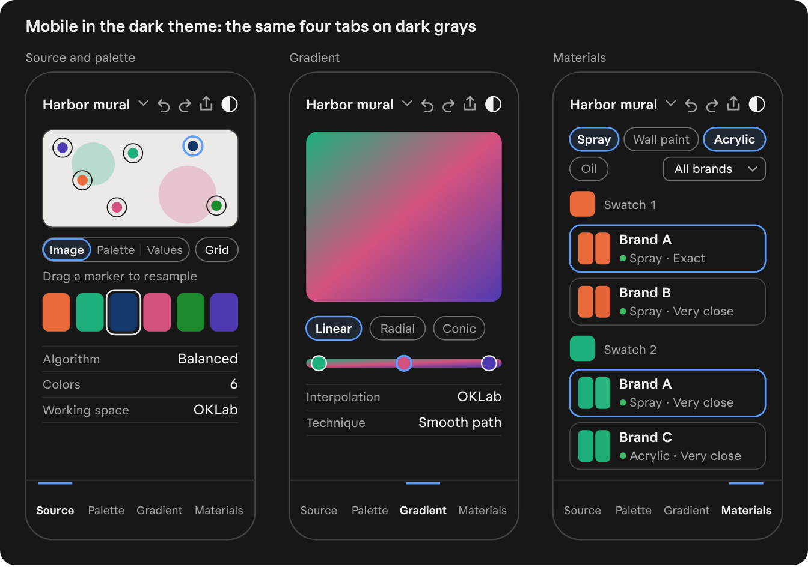

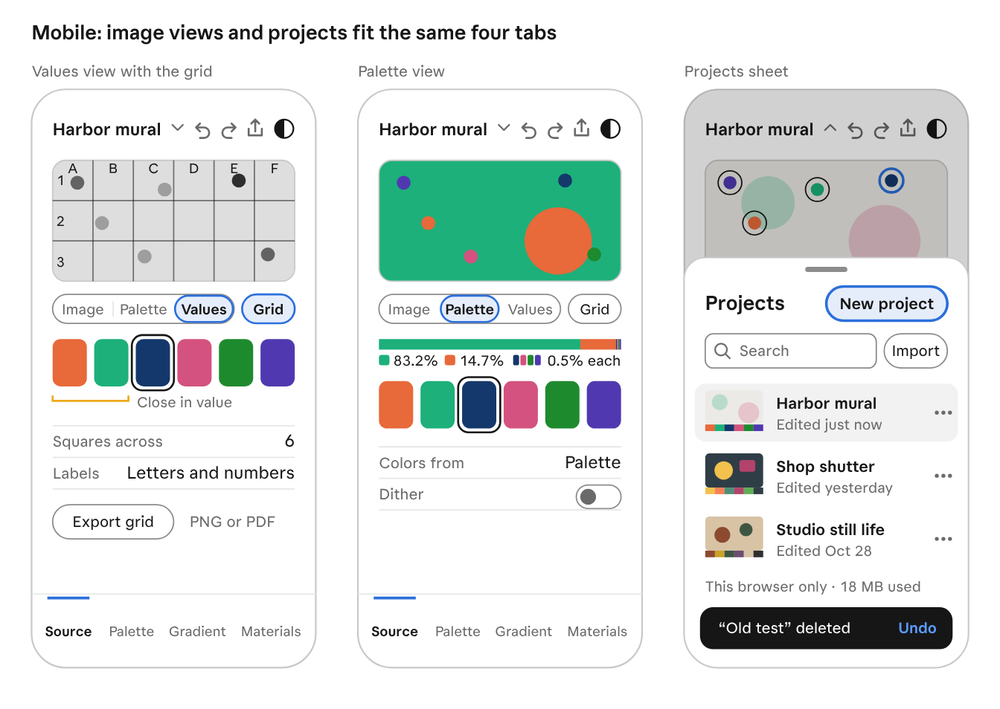

On phones the new features fit the same four tabs. The view bar sits under the image on the Source tab, the close pair is marked on the swatch strip in the Values view, and the library opens as a bottom sheet from the project name, with an undo toast after a delete.

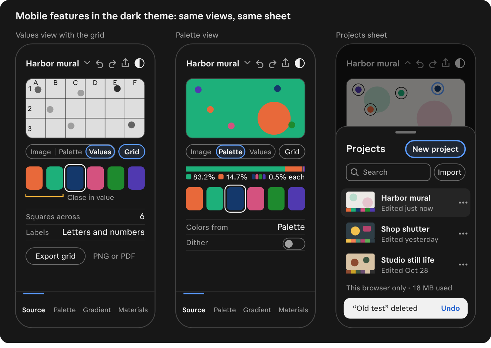

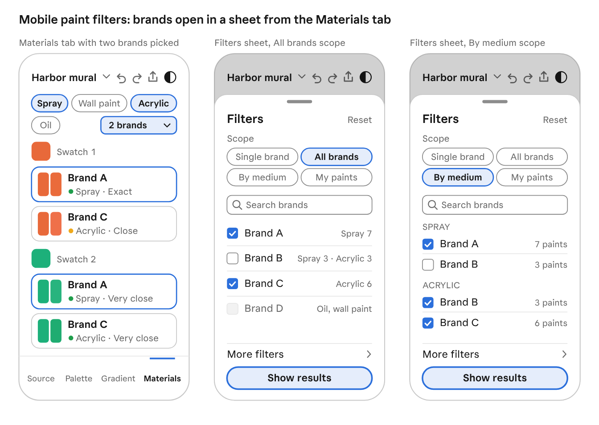

**Paint filters on phones (light, then dark).** The brand control on the Materials tab opens a Filters sheet, with the scope at the top as on desktop. In All brands, the brand list is searchable and shows how many paints each brand has in the selected mediums; a brand with none, like Brand D here, is dimmed. In Single brand the checkboxes become a single choice, and in By medium the list splits into one section per selected medium, so each medium gets its own brands. Series, finish, opacity, discontinued paints, results per swatch, unique paints, the metric and the ΔE threshold sit under More filters. Show results closes the sheet, and the control then says how many brands are picked.

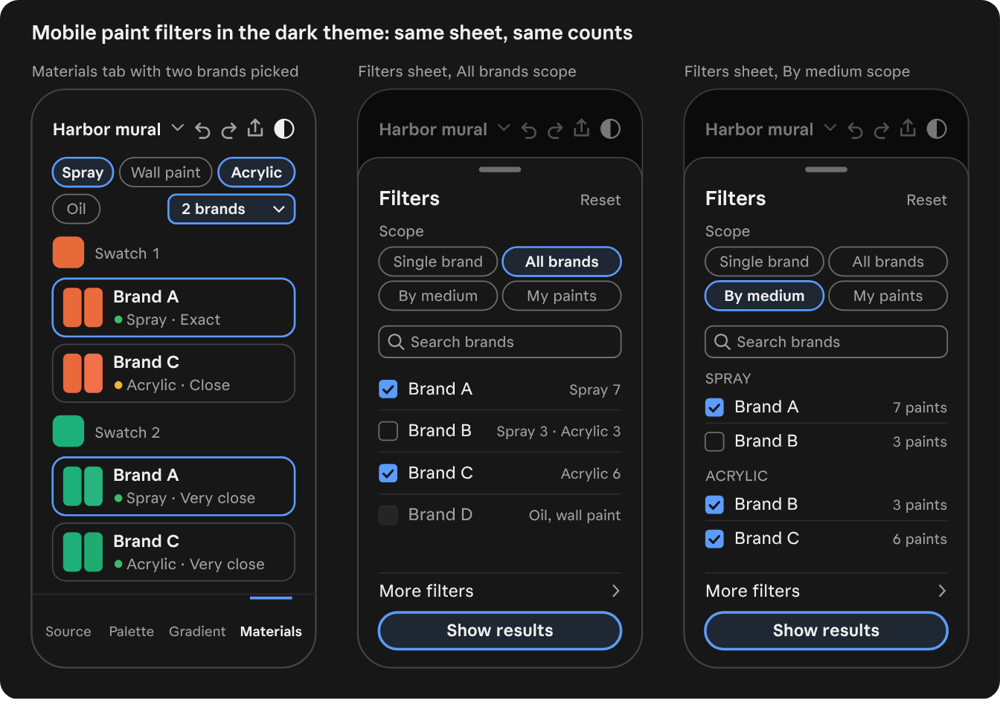

- On narrow screens the three columns and Materials become four tabs.
- Input: drag and drop, paste from clipboard, file picker, built-in sample images.
- Image view: zoom, pan, eyedropper, region-of-interest tool, cluster-map overlay, draggable sample points (3.7), and the view bar with Image, Palette and Values views and the transfer grid (3.8).
- UI chrome is neutral gray so it doesn’t bias color judgment, and previews have a surround setting (6.2).
- Keyboard: Ctrl/Cmd+Z and Ctrl/Cmd+Shift+Z for undo and redo, arrow keys to reorder swatches, E for eyedropper, R to re-extract, C to copy the selected swatch, and ? for a shortcut sheet. Single-letter shortcuts are off while a text field has focus.
- Respects reduced-motion and the system light or dark setting (see 6.2); labeled controls and visible focus for accessibility.
- Supported images: JPEG, PNG, WebP, GIF (first frame), AVIF and SVG where the browser decodes them. HEIC decodes in Safari on iOS and macOS but not in most other browsers, so show a clear message there. Warn above roughly 30 megapixels.
- Color management: the canvas reads pixels in sRGB, so v1 works in sRGB and flags out-of-gamut results; Display-P3 canvas support is a later option.

### 6.1 Small devices: iPhone and Android phones

Phones are a supported target from v1. The layout is designed mobile-first, and the desktop view uses the same components with more room. The mobile mockups above show the phone layout.

| Width | Layout |
| --- | --- |
| Up to 600 px (phones, from 320 px) | One panel at a time as four tabs (Source, Palette, Gradient, Materials); the swatch editor, adjustments, ramps and export open as bottom sheets |
| 601 to 1023 px (tablets, landscape phones) | Two columns: Source and Palette beside the active panel |
| 1024 px and up | Three columns plus the export drawer, as in the desktop mockup |

**Requirements**

- **Viewport and safe areas:** set `viewport-fit=cover`, pad the tab bar and sheets with `env(safe-area-inset-bottom)` so the home indicator doesn’t cover them, and use `dvh` units instead of `vh` so Safari’s toolbar doesn’t clip the layout.
- **Touch targets:** every control is at least 44 × 44 px, and each image marker gets a 44 px hit area around its visible ring.
- **Gestures:** one finger on a marker drags it, one finger elsewhere pans, two fingers pinch-zoom the image. Set `touch-action: none` on the image and markers so the page doesn’t scroll or zoom mid-drag, use pointer events with pointer capture, and handle `pointercancel`.
- **No hover:** everything hover does has a tap equivalent. Tapping a marker or a swatch selects both, and the cluster map becomes a toggle in the swatch sheet.
- **Text input:** fields use at least 16 px type so iOS Safari doesn’t zoom on focus; numeric fields use `inputmode='decimal'`; the HEX field turns off autocorrect and autocapitalize.
- **Sliders and buttons:** sliders have large thumbs plus number steppers, and Undo and Redo are visible buttons because phones have no keyboard shortcuts.
- **Callouts:** turn off the iOS image callout and text selection on markers and canvases (`-webkit-touch-callout: none`, `user-select: none`) so a long press doesn’t open the share menu mid-drag.
- **Getting images in:** a file picker that offers Photo Library, Take Photo and Files. iPhone photos can be HEIC; Safari can decode them and iOS usually converts them to JPEG in the picker, and browsers that can’t decode HEIC show the clear message.
- **Eyedropper:** the browser EyeDropper API isn’t available on iOS, so the built-in point sampling (3.7) is the eyedropper.
- **Export:** use the share sheet where supported (check with `navigator.canShare`) so files and images can be saved to Files or Photos, with Copy and Download as fallbacks.
- **Memory and canvas limits:** iOS Safari has long capped a canvas at 16,777,216 pixels (4096 × 4096), reportedly raised to 8192 × 8192 in iOS 18, and it also limits total canvas memory. So: draw large photos down into a small working canvas, never hold a full-size one; sample marker colors from a small crop of the decoded bitmap; cap raster export at 4096 px on phones unless a test canvas succeeds at more, and show a clear message if it fails; reuse one canvas rather than creating many; call `close()` on bitmaps you no longer need.
- **Storage:** Safari can clear a site’s local storage after about a week without a visit, and web apps installed to the Home Screen are exempt. Local catalogues and My paints (Part 2) therefore carry an Export reminder, and installing to the Home Screen is the recommended way to use the tool on iPhone (see PWA in 7.8).
- **Phone defaults:** the sample size defaults to 128 px, and live updates during drags run once per animation frame (3.7).
- **Orientation and theme:** portrait first, landscape uses the two-column layout; light and dark mode and reduced motion are respected.

Sources: [Canvas area limit on iOS Safari](https://pqina.nl/blog/canvas-area-exceeds-the-maximum-limit/); [Report of the limit rising in iOS 18](https://lionpuro-com.pages.dev/posts/canvas-is-finally-usable-on-safari).

### 6.2 Themes: light and dark

Both themes ship in v1. The default follows the device setting, and a header control switches between System, Light and Dark. The mockups above show both themes, with the theme button in the header.

**Behavior**

- **Default and override:** the root sets `color-scheme: light dark`, so the app follows the device with no script. A manual choice sets `color-scheme: light` or `dark` through a `data-theme` attribute and is saved in localStorage as an app setting, not in project files or share links.
- **No flash on load:** a small external script in the head (not inline, because the CSP in 7.8 blocks inline scripts) reads the saved choice and sets `data-theme` before first paint.
- **Live switching:** changing the device theme updates the app at once, without a reload.
- **Browser chrome:** add `theme-color` meta tags for light and dark so the Safari toolbar on iPhone matches, with matching colors in the web app manifest (7.8).

**Design rules**

- **Tokens:** every UI color is a CSS custom property defined once for both themes (with `light-dark()`, which current browsers support), never hard-coded in a component. Icons use `currentColor`.
- **Neutral chrome:** both themes use untinted grays and a single accent color, so the interface doesn’t bias color judgment (section 6). The dark theme uses dark gray, not pure black.
- **Content is never themed:** the source image, swatches, gradient preview and exported files show identical colors in both themes. Only the surround changes, and a preview-surround setting (Match theme, Mid-gray, White, Black) lets you judge colors on a neutral background.
- **Background-dependent tools:** the text-overlay check (4.4), the contrast matrix (3.5) and image export backgrounds (5.4) use the preview or export background, never the UI theme.
- **Contrast:** text meets WCAG 2.x AA (4.5:1) and controls and focus rings meet 3:1 in both themes. Sample markers (3.7) keep a light outer and dark inner stroke so they stay visible on very light and very dark images.

**Acceptance**

1. First visit follows the device theme; a manual Light or Dark choice survives a reload, and changing the device theme updates the app without one.
2. No flash of the wrong theme on load.
3. Swatch, image and gradient colors are identical in both themes (a screenshot comparison of the preview areas).
4. All text and controls meet AA contrast in both themes, and markers are visible on very light and very dark images.

### 6.3 States and feedback

Every panel has a defined empty, loading and error state, so the tool never shows a blank or frozen screen.

| Situation | What the user sees |
| --- | --- |
| First visit, no image | A drop zone with Choose image, Paste and three sample images; the other panels show a one-line hint |
| Extracting or rendering | The previous result stays visible and dims slightly; a progress bar appears only after about 300 ms (7.4) |
| Unsupported or unreadable file | An inline message naming the format and the formats that work; the previous image stays loaded |
| Very large image | A note above about 30 MP, then automatic downscaling to the working master (7.4) |
| Export too large for the device | A message suggesting a smaller size; the app keeps running |
| Copy or export done | A short toast (Copied HEX, Saved PNG); a failure says why and offers Download instead |
| Catalogue missing or invalid (Part 2) | The catalogue manager shows the validation report, and matching skips that catalogue |

Messages are plain sentences with at most one action, and screen readers hear them through a live region.

### 6.4 Visual design

The look is minimal: neutral surfaces, one accent color, and the user’s colors as the only saturated things on screen, as in the mockups above.

- **Type:** the system font stack (no web fonts, see 7.8) at 12, 13, 15 and 20 px, with tabular figures so columns of color values line up.
- **Spacing and shape:** a 4 px grid, 8 px between related controls and 16 px between groups; corner radius 6 px on inputs, 8 px on swatches, 10 to 12 px on cards and panels, and full pills for chips and toggles.
- **Color:** neutral grays for surfaces, borders and text; one blue accent for selection, focus and the primary action; green and amber only for match quality (14.3).
- **Icons:** one outline set at a 1.5 px stroke in 16 and 20 px sizes, for example Lucide, imported per icon.
- **Motion:** 120 to 200 ms ease-out for sheets, tabs and hover states, never on color values, and none when reduced motion is requested.
- **Density:** 32 px controls on desktop and 44 px touch targets on phones (6.1).

### 6.5 Sharing

The Share button in the header creates a link that reopens the current work: palette, adjustments, gradients, settings and chosen paints, encoded as described in 5.3. The image never goes into the link.

- **Desktop:** Share copies the link and confirms with a toast that lists what it holds, for example 6 swatches, 1 gradient, no image.
- **Phones:** Share opens the system share sheet (`navigator.share`) so the link can go to Messages, Mail or Notes. Where the share sheet isn’t available, it copies the link as on desktop.
- **Options:** a small popover lets you leave out gradients, extraction settings or paint matches; by default everything is included.
- **Opening a link:** the shared state opens as a new, unsaved project with a banner saying it came from a link and a Save to library button (5.5), and it never overwrites the recipient’s autosaved work without asking. With no image, sample points stay hidden (3.7); the recipient can load an image and re-extract, or keep the shared palette as it is.
- **Long links:** if the link grows very long (many swatches or a mesh gradient), Share offers a project file instead (5.3).
- **Privacy:** the part of the link after # stays in the browser and is never sent to GitHub Pages, but anyone who has the link can read the colors in it.

**Acceptance**

1. Share copies a link on desktop and opens the share sheet on iPhone.
2. Opening the link in another browser reproduces the palette and gradients exactly, without touching that browser’s autosave.
3. No image data ever appears in a link.

### 6.6 Keeping the interface calm

The tool keeps gaining features, so these rules decide where each one goes. The mockups above follow them.

1. **Attach features to the thing they act on, not to a new panel.** Image views and the grid live on the image (3.8). The library lives behind the project name. Area shares appear in the palette view.
2. **Show options only when they apply.** The rows under the image change with the view. Chevron rows expand in place. Advanced extraction settings start collapsed. On phones, secondary tools open as bottom sheets.
3. **The header holds only global actions:** project, views, Undo, Redo, Share and theme. Autosave replaces Save (5.5).
4. **One emphasis per region.** At most one accent element per panel; everything secondary is muted text.
5. **Feature budget.** A new feature that needs an always-visible control must replace or merge with an existing one, or justify itself at design sign-off. Otherwise it goes behind a menu, a sheet or a contextual row.
6. **Same structure everywhere.** Desktop columns and phone tabs hold the same controls in the same order, so nothing has to be learned twice.

## 7. Technical architecture

### 7.1 Stack

- **Stack: Vite + TypeScript (decided).** Strict TypeScript, ES modules and Preact for the UI (about 4 kB runtime). Vitest covers unit tests for color math, parsers and exporters.
- **Deployment:** a GitHub Actions workflow builds the app and publishes it to GitHub Pages on every push to the main branch.
- **Workers:** extraction and catalogue parsing run in module Web Workers bundled by Vite, with message types shared between worker and UI.
- **State:** @preact/signals holds the app state, one signal per field of the data model in 7.5, so a marker drag updates only the swatch, gradient preview and contrast checks that depend on it. A small history stack stores snapshots for undo and redo.

### 7.2 Libraries

Install libraries with npm and let Vite bundle them, with versions pinned by the lockfile, instead of loading from a CDN, so the tool works offline and can’t break when a CDN changes.

- **Preact and @preact/signals** (MIT, about 4 kB): the UI layer and state. Components are `.tsx` files, and native elements (`dialog`, `details`, range inputs) come before any component library.
- **culori** (MIT): conversions, interpolation, gamut mapping, ΔE including CIEDE2000. Alternative: hand-roll OKLab and CIEDE2000, which is a few hundred lines.
- **Lucide icons** (ISC): imported per icon, so only the icons used ship.
- **vite-plugin-pwa** (MIT): manifest and service worker generation (7.8).
- **Material Color Utilities** (Apache 2.0, optional): reference for the scoring step.
- Everything else (k-means, median cut, Wu, ASE and GPL writers, CSV parser, WCAG contrast, CVD matrices) is small enough to write directly.
- **Dev tooling** (not shipped): Vite with `@preact/preset-vite`, TypeScript with `jsx: react-jsx` and `jsxImportSource: preact`, Vitest for unit tests, Playwright for end-to-end tests, axe-core for accessibility checks, and Biome for linting and formatting.

### 7.3 Repository layout

```
/
├─ index.html
├─ package.json, package-lock.json
├─ tsconfig.json          strict mode
├─ vite.config.ts         base path, Preact and PWA plugins
├─ biome.json             lint and format rules
├─ .github/workflows/     ci.yml (every push and PR), deploy.yml (main only)
├─ public/
│  ├─ theme-init.js       sets the theme before first paint (6.2)
│  ├─ icons/              app icons for the manifest
│  ├─ data/               paint catalogues and their manifest (Part 2)
│  └─ samples/            demo and test images
├─ src/
│  ├─ main.tsx
│  ├─ types.ts            shared types: Project, Swatch, Gradient, Paint
│  ├─ styles/             tokens.css, app.css
│  ├─ state/              signals.ts, history.ts, serialize.ts, migrate.ts, autosave.ts
│  ├─ image/              load.ts, tiers.ts, sample.ts, views.ts (palette, values, grid)
│  ├─ extract/            worker.ts, histogram.ts, median-cut.ts, wu.ts, kmeans.ts,
│  │                      swatches.ts, even-spread.ts, markers.ts, postprocess.ts
│  ├─ color/              convert.ts, delta-e.ts, gamut.ts, cvd.ts, contrast.ts,
│  │                      ramps.ts, harmony.ts
│  ├─ palette/            model.ts, adjust.ts
│  ├─ gradient/           model.ts, sources.ts, interpolate.ts, bake.ts, css.ts,
│  │                      render-worker.ts, mesh.ts
│  ├─ library/            store.ts, thumbnails.ts (5.5)
│  ├─ match/              Part 2 matching (section 17)
│  ├─ export/             palette-*.ts, gradient-*.ts, paint-*.ts, ase.ts, gpl.ts
│  └─ ui/                 Preact components (.tsx)
├─ tools/                 validate-catalogues.ts, build-manifest.ts, convert-swatches.ts
├─ tests/                 Vitest unit tests and fixtures
├─ e2e/                   Playwright tests (desktop and phone profiles)
└─ README.md, LICENSE, DATA-NOTICE.md
```

### 7.4 Data flow and concurrency

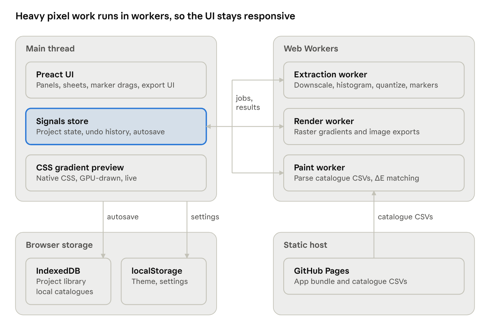

The store posts jobs with transferred buffers to three workers and gets results back. Autosave and settings stay in the browser, and the only network traffic is same-origin static files from GitHub Pages.

File → `createImageBitmap` (with orientation from the image) → OffscreenCanvas downscale in a Worker → weighted histogram (OKLab) → quantizer → swatches → store → UI.

- Debounce settings changes (about 120 ms); tag jobs with an id and drop stale results.
- Transfer buffers to and from workers rather than copying.
- Show a progress indicator only if work exceeds about 300 ms.
- Fall back to the main thread where OffscreenCanvas in workers is unavailable.

**Image tiers.** The original file stays as a Blob and is never held decoded at full size. It is decoded once into a working master of at most 4096 px on the longest edge (about 12 MP, roughly 50 MB in memory), which drives the on-screen image, marker sampling (3.7) and the autosave copy (5.3). Extraction runs on a much smaller analysis copy at the sample size (2.4). This keeps a 48 MP phone photo within iOS memory limits (6.1).

### 7.5 Data model

| Object | Fields |
| --- | --- |
| Project | schemaVersion, extraction settings, base swatches, adjustments, palette, gradient, export preferences, image meta, view settings (view, bands, grid) |
| Swatch | id, OKLCH color, alpha, name, locked, origin, population, image point (x, y from 0 to 1), sample radius |
| Adjustments | lightness, chroma, hue, contrast, temperature, tint, gamma, lightness range, gamut mode |
| Gradient | type, geometry, interpolation (space, hue method, premultiplied), stops (position, color ref or value, alpha, hint), source technique and parameters, easing, grain |
| Image meta | name, pixel size (the pixels themselves are never saved) |
| Library entry | id, name, created, edited, thumbnail, project, working image (stored in IndexedDB, 5.5) |

### 7.6 Algorithm notes

- **Histogram:** quantize to 5 bits per channel, store count and mean OKLab color per bin; every algorithm runs on these weighted bins.
- **K-means++:** weighted, Euclidean in OKLab, seeded PRNG (for example mulberry32), restarts keep the lowest error, empty clusters reseed to the farthest point, stop when the largest centroid shift falls below 1e-4 or the iteration cap is reached.
- **Median cut:** split the box with the largest range (optionally weighted by count × volume, as MMCQ does) at the population median.
- **Wu:** cumulative moment tables over the 5-bit histogram; choose cuts that maximize between-class variance.
- **Merge:** agglomerative, merging swatches closer than the threshold into a population-weighted average.
- **Labels:** role names from target lightness and saturation windows; color names from the nearest CSS color in OKLab.
- **Bake:** for t in \[0, 1\], apply easing, interpolate in the chosen space (premultiplied alpha, hue method), gamut-map by reducing OKLCH chroma, convert to sRGB.
- **Smooth-path ordering:** nearest-neighbor tour followed by 2-opt for up to about 32 colors.
- **Mesh:** weights w = exp(-d² / 2σ²), normalized, blend in OKLab; render at up to 512 px, upscale smoothly, add grain.

### 7.7 Performance targets (to be validated)

First palette within about 500 ms of loading a 12 MP photo on a mid-range laptop; re-extraction after a settings change under about 150 ms at 256 px; 60 fps gradient preview while dragging; raster export up to 4096 px in about a second.

Load budget (also to be validated): under about 150 kB of compressed JavaScript on first load, with the export writers, raster renderer and Part 2 code split into chunks loaded on first use; usable within about 2 s on a mid-range phone. CI reports bundle size on every build so regressions show up early.

### 7.8 Hosting, privacy and security

- **Deployment:** Settings → Pages → set the source to GitHub Actions and deploy with a workflow that runs npm ci and npm run build, then publishes the dist folder. Pages is available for public repositories on the free plan; private repositories need a paid plan.
- **Limits:** published sites may be up to 1 GB, with a soft bandwidth limit of 100 GB per month and a soft limit of 10 builds per hour (which doesn’t apply to custom Actions workflows). A tool this size is nowhere near any of them.
- **Paths:** project sites are served from `/repo-name/`, so set `base` in `vite.config.ts` and build data and asset URLs from `import.meta.env.BASE_URL`. A `.nojekyll` file isn’t needed, because an Actions deployment publishes the built folder as is.
- **CSP:** Pages can’t set HTTP headers, so use a meta tag, for example `default-src 'self'; img-src 'self' blob: data:; worker-src 'self' blob:`; object-src 'none'; base-uri 'self'; form-action 'none', with no inline scripts. Apply it in the production build only, since the dev server’s hot reload needs looser rules.
- **Privacy and input safety:** no analytics, no external fonts (system font stack), no network requests after load, no cookies. State the no-upload guarantee in the UI. Project files, share links and CSVs are treated as untrusted: they are schema-checked and size-capped before use, nothing from them is inserted as HTML, and SVG images are decoded as images, so any scripts in them never run.
- **PWA (M6):** manifest and service worker (vite-plugin-pwa) for offline use and Add to Home Screen, scoped to the repo path and recommended for iPhone (6.1). The app shell and loaded catalogues are cached; when a new version is deployed, a toast offers Reload, so an update never interrupts an edit.
- **Browser targets:** current Chrome, Edge, Safari (macOS and iOS) and Firefox; feature-detect `OffscreenCanvas`, `createImageBitmap` and `CSS.supports`.

### 7.9 Color gamut: sRGB first, Display-P3 as a later option

Decision: v1 ships in sRGB, and the internals stay gamut-agnostic so Display-P3 can be added later without rewrites. Wide gamut mostly matters for very saturated photos from recent phones viewed on wide-gamut screens, and most of your targets (Affinity, Figma, Adobe, paint matching) work in sRGB.

| Area | sRGB only (v1 plan) | With Display-P3 |
| --- | --- | --- |
| Image reading | Canvas converts every image to sRGB, so the most saturated colors in a P3 photo are clipped before extraction | Read pixels as Display-P3 through the canvas `colorSpace` option. It works in Chrome, Edge and Safari but not Firefox, so detect support and fall back to sRGB |
| Editing | Gamut indicator for sRGB; chroma is reduced to fit | Gamut mode switch (sRGB, P3, none) and a second boundary on the chroma sliders |
| Gradients | Baked stops are sRGB hex | CSS output in `oklch()` or `color(display-p3 ...)` with an sRGB fallback line; the difference shows only on wide-gamut displays |
| Palette export | HEX, ASE, GPL and Tailwind are all sRGB | Only CSS (oklch, display-p3) and JSON can carry P3; ASE and GPL hold plain RGB with no profile, so P3 colors must be gamut-mapped for them |
| Image export | sRGB PNG, no profile | A P3 PNG needs an embedded profile; export from canvas is inconsistent across browsers, so verify before promising it |
| Paint matching | Catalogue hex is sRGB and ΔE is computed from it | No gain: paints are physical and catalogue values are sRGB, so matching stays in sRGB |
| Testing | Any screen | Needs a wide-gamut display to see differences (detect with the `color-gamut` media query) |

**Make P3 cheap later:** keep colors as OKLCH floats (already in the data model), put all gamut mapping in one module (`color/gamut.ts`) that takes a target gamut, and store a per-project gamut setting that defaults to sRGB.

**Sequencing:** v1 in sRGB. P3 image reading, gamut modes and P3 CSS output stay a possible later addition and are not on the roadmap.

Sources: [Canvas color management support](https://web-platform-dx.github.io/web-features-explorer/features/canvas-2d-color-management); [WebKit: Wide Gamut 2D Graphics using HTML Canvas](https://webkit.org/blog/12058/wide-gamut-2d-graphics-using-html-canvas/).

### 7.10 Licensing: public repository under MIT

The repository is public and the code is MIT licensed. GitHub Pages is free for public repositories (7.8).

- **Code:** MIT. Add a `LICENSE` file and a short notice in the app footer.
- **Dependencies:** keep each dependency’s license notice in the build output. culori, Preact and vite-plugin-pwa are MIT, Lucide is ISC, and Material Color Utilities (if used) is Apache 2.0; all are compatible with MIT. Dev-only tools aren’t shipped, so their licenses don’t affect the published app. Check the license of every new dependency before adding it.
- **Mixbox:** don’t bundle it. Its CC BY-NC 4.0 license forbids commercial use, which conflicts with MIT’s permissions for anyone who copies the repository. Mix suggestions (14.6) use the in-house model instead.
- **Catalogue data (Part 2):** committed CSVs are public, and MIT covers the code, not necessarily the data. Brand names and color codes belong to their owners, and hex values may come from sources with their own terms. Record each catalogue’s source and terms in `public/data/README.md`, commit only data you may redistribute, and keep the rest as local imports (13.1). Add a separate data notice so nobody reads MIT as covering it.
- **Sample images:** `public/samples/` holds only your own images or openly licensed ones, with credits listed. Images users load never leave their browser.

## 8. Testing and acceptance criteria

**Unit tests**

- Color conversions against reference values (sRGB white maps to OKLab L = 1, a = b = 0; round-trip error below 1e-6).
- ΔE implementations against published reference data (for CIEDE2000, the Sharma test pairs).
- K-means output identical for the same seed, and every algorithm stable on single-color, two-color and fully transparent images.
- Gradient baking: baked stops stay within 1/255 of the chosen interpolation at sampled points.
- Image views: every Palette-view pixel equals a palette color and area shares sum to 100%; the 5-band Values view yields exactly 5 grays; the grid has square cells and correct labels for several aspect ratios.
- Exporters: ASE header and block structure, GPL parse, JSON schema; numbers use a period as the decimal separator under any locale.
- Project files: a fixture for every older `schemaVersion` migrates cleanly to the current one.
- Library: create, rename, duplicate, delete with undo, and reload, all without loss.

**Visual tests**

- Golden images for raster gradients; CSS preview versus raster export within 2/255 per channel (excluding dither).

**Fixture images:** photo with dominant sky, flat illustration, pixel art, low-contrast scene, mostly white background, transparent PNG, grayscale, very large image.

**Continuous integration**

- Every push and pull request runs lint, type-check, unit tests, the catalogue validator (13.4), a production build with the bundle-size report (7.7), and a Playwright smoke test in Chromium, WebKit and Firefox.
- axe-core checks each panel for accessibility problems, in light and dark themes.
- Deploys run only from main and only after every check passes.

**v1 acceptance**

1. Load an image by drop, paste or picker, and see a palette in under a second for typical photos.
2. Switch algorithm and settings with live updates; the same seed gives the same palette.
3. Edit, lock, reorder and adjust swatches, and drag sample points, with full undo.
4. Switch between the Image, Palette and Values views and toggle the transfer grid without re-extraction; export the grid as PNG and PDF (3.8).
5. Build linear, radial and conic gradients from any technique in 4.2, with a chosen interpolation space; palette edits flow into linked stops.
6. Preview matches exported CSS and raster output.
7. Export palette and gradient independently in all v1 formats; ASE opens in Affinity and Adobe apps, and GPL in GIMP.
8. Keep several projects in the library and switch between them; a reload restores the library and the open project, image included, on the same device (5.5).
9. Works as a static site under a repo subpath on GitHub Pages with no network after load.
10. Keyboard-operable with visible focus and sufficient UI contrast; the phone (6.1) and theme (6.2) acceptance lists pass.

**Small-device tests**

- Layout checks at 320, 375, 390 and 430 px wide, portrait and landscape: no horizontal scroll, no clipped controls, tab bar clear of the home indicator.
- Automated: Playwright with WebKit and phone device profiles. It catches layout and basic touch problems, but not real memory or gesture behavior.
- Real devices before each release: a recent iPhone on the current iOS, an older iPhone on an older iOS, and one Android phone with Chrome.
- Stress cases on iPhone: a 12 MP and a 48 MP photo; repeated extractions and exports without the tab reloading; a 4096 px raster export; first palette for a 12 MP photo in about 1 s (target to validate).
- Touch: drag a marker without the page scrolling, pinch-zoom the image, and export through the share sheet.

**Small-device acceptance**

1. Every feature in Parts 1 and 2 is reachable on a 320 px wide screen without horizontal scrolling.
2. All controls are at least 44 × 44 px, and nothing depends on hover.
3. Dragging a marker on iPhone moves only the marker: no page scroll, zoom or share callout.
4. Text fields don’t trigger Safari’s focus zoom.
5. A 48 MP iPhone photo loads and extracts without the tab reloading, and a 4096 px gradient export completes or fails with a clear message.
6. Export works through the share sheet, with Copy and Download as fallbacks.
7. The tab bar and sheets clear the home indicator and notch, and an app installed to the Home Screen opens full screen.

## 9. Roadmap

| Milestone | Scope |
| --- | --- |
| M1 Foundation | Load image, sampling, median cut and k-means, swatch strip, responsive shell (desktop and phone layouts), copy HEX and CSS variables, CI checks, state store, Vite + TypeScript + Preact scaffold, light and dark theme tokens, GitHub Actions deploy |
| M2 Extraction depth | Wu, Balanced, exact colors, even spread, swatch roles, filters, region of interest, cluster map, presets |
| M3 Palette editing | Color editor, adjustments, locking, undo/redo, ramps and harmonies, contrast matrix, CVD simulation, draggable sample points on the image, Palette and Values image views (3.8) |
| M4 Gradients | Linear, radial, conic, stop sources, interpolation spaces, baked stops, easing, preview and compare mode |
| M5 Export suite | All palette and gradient formats, target presets (Affinity, Figma, Adobe), stop sheet, image export, raster renderer, project files with migrations, project library with autosave (5.5), transfer grid and its export (3.8), share link |
| M6 Polish | Mesh and stepped gradients, repeating types, PWA, shortcut sheet, empty and error states (6.3), accessibility audit, real-device phone testing |
| Later | Octree, Procreate and `.aco` export, Display-P3 support, WebGL renderer, multi-image palettes, saved gradient variations, Figma plugin |

M1 to M6 run in order. Part 2 (M7 to M9, section 19) needs only a finished palette, so it can start once M3 is done and run alongside M4 to M6.

## 10. Decisions (Part 1)

1. Which tools do you export to most (Figma, Adobe, Procreate, Tailwind or plain CSS)? Answered: Affinity first, then Figma, Adobe and image export (section 5.4).
2. Zero-build (Option A) or Vite + TypeScript (Option B)? Answered: TypeScript with Vite, and Preact + signals for the UI (section 7.1).
3. Display-P3 support in v1, or sRGB first? Answered: sRGB for v1 (see 7.9); Display-P3 stays a possible later addition.
4. Single image only, or palettes combined from several images? Answered: single image first; multi-image palettes stay in the Later roadmap row.
5. Public repository, and which license? Answered: public repository under the MIT license (see 7.10).

**Still open:** the product name. The mockups say Palette Studio and this document says Palette & Gradient Studio; pick one before M1 so the repository name, manifest and page title match.

## 11. References

- [Gradient interpolation, web platform feature status](https://web-platform-dx.github.io/web-features-explorer/features/gradient-interpolation)
- [GitHub Pages limits (GitHub Docs)](https://docs.github.com/en/pages/getting-started-with-github-pages/github-pages-limits)
- [K-means vs median cut vs octree palettes (AppCrib)](https://appcrib.pages.dev/blog/kmeans-median-cut-octree-palette-extraction/)
- [Survey of color quantization methods, Digital Color Imaging (arXiv)](https://arxiv.org/pdf/cs/0109116)
- Original methods: Heckbert (median cut, 1982); Gervautz & Purgathofer (octree, 1988); Wu (1992); Ottosson (OKLab, 2020).

## 12. Part 2: Paint catalogue matching

This part extends the tool so the current palette (after any edits) can be mapped to real paints from catalogues you supply: spray paint, acrylic, gouache, oil, enamel, markers and so on. Matching runs in the browser against CSV files stored in the repository (or imported locally), for one brand, across all brands, or split by medium.

**Scope**

- In: catalogue CSV format and validation, loader and local import, color-difference matching, brand, medium and finish filters, grouping, a My paints list, snap-to-paint, shopping-list and card exports.
- Later: mix recipes, measured-data tooling, links to live price and stock.
- Out: scraping inside the app, ordering, live prices.

**Reality check.** Catalogue hex values are normally screen renderings of swatches, not measurements. Paints also dry differently from how they look wet (acrylics and wall paints typically dry darker, and oils can yellow over time), metallic, pearl, fluorescent and glitter paints can’t be described by one hex value, and the sRGB and pigment gamuts overlap but neither contains the other. The tool therefore reports distance and direction (lighter, less saturated, hue shift) and flags low-confidence entries. Treat results as a shortlist to verify on a physical swatch card, not a guarantee.

## 13. Catalogue data

### 13.1 Storage and loading

GitHub Pages can’t list a directory, so a manifest file describes what exists. Catalogues are fetched on demand when selected.

```
public/
  data/
    catalogues.json                 manifest
    README.md                       schema and contribution notes
    catalogues/
      <brand-slug>/
        <medium>-<series>.csv       for example spray-standard.csv
tools/
  validate-catalogues.ts            run with tsx, also in CI
  build-manifest.ts
  convert-swatches.ts               ASE, ACO and GPL to catalogue CSV (13.5)
```

- A typical catalogue has 100 to 3,000 rows, well under 500 KB. Even dozens of catalogues sit far below the 1 GB Pages limit.
- **Local catalogues:** drag in a CSV (mapping its columns to the schema) or a brand swatch file in ASE, ACO or GPL format (converted as in 13.5), and it is stored in IndexedDB on your device only. Use this for data you don’t want in a public repository.
- If the repo is public, committed CSVs are public. Check each data source’s terms before publishing it.

### 13.2 CSV schema

UTF-8, comma-delimited, header row, RFC 4180 quoting, one row per paint.

| Column | Required | Notes |
| --- | --- | --- |
| brand | Yes | Display name |
| medium | Yes | spray, wall-paint (acrylic wall paint), acrylic (studio acrylic), oil; watercolor is planned (the list is configurable) |
| series | No | Range or line, for example Heavy Body |
| code | Recommended | Manufacturer color number or SKU; part of the paint id |
| name | Yes |  |
| hex | Yes, unless Lab is given | #RRGGBB |
| lab\_l, lab\_a, lab\_b, lab\_illuminant | No | Measured CIELAB; illuminant D50 or D65 (default D65). Takes priority over hex |
| finish | No | matte, eggshell, satin, gloss, metallic, pearl, fluorescent, glitter, other |
| opacity | No | opaque, semi-opaque, transparent |
| pigments | No | Pigment index codes separated by semicolons, for example PB29;PW6 |
| ref\_codes | No | Color-system equivalents separated by semicolons, for example RAL 5015;NCS S 2050-B. Shown on result cards; useful when a shop mixes wall paint to order and for spray lines that list RAL equivalents |
| lightfast | No | Rating as published; the scale is noted in the manifest |
| size | No | Container size or sizes |
| price, currency | No |  |
| url | No | Product page |
| source | Recommended | manufacturer, retailer, measured, community |
| confidence | Recommended | measured, manufacturer, approximate |
| updated | No | ISO date |
| discontinued | No | yes or no |
| notes | No |  |

Unknown columns are preserved on import and re-export.

### 13.3 Manifest entry

Each catalogue is listed in `catalogues.json` with: id, brand, medium, series, file, row count, updated date, color confidence (measured, manufacturer or approximate) and a source note. The UI reads this to build the catalogue manager.

### 13.4 Sourcing and quality

- Best data is measured CIELAB, next is the manufacturer’s own swatch data, weakest is retailer or community hex. Record which in `source` and `confidence`; the UI shows a confidence badge and can down-rank approximate entries.
- Different sites often publish different hex values for the same paint, so keep one source per catalogue file.
- The validation tool (TypeScript run with tsx, runnable locally and as a GitHub Actions check) verifies the header, required fields, hex format, duplicate brand + medium + code, controlled vocabulary, UTF-8 encoding and manifest row counts, and normalizes hex to uppercase.
- If your CSVs arrive in different shapes, the import wizard (or a one-off converter script) maps the columns, so no manual reformatting is needed.

### 13.5 Building catalogues

Catalogues come from four routes, listed from best data to weakest. Every route ends the same way: one CSV per brand, medium and series, checked by the validator and listed by the manifest builder (13.4), then committed only if the data may be redistributed (7.10).

| Route | Input | confidence value | Effort |
| --- | --- | --- | --- |
| Measure | Colorimeter readings of your own dried swatch cards | measured | High per color, best accuracy |
| Brand swatch file | ASE, ACO or GPL libraries that some brands publish for designers | manufacturer | Low: converted automatically |
| Manual entry | Product pages or PDF charts typed into a spreadsheet | manufacturer or approximate | Medium; suits small ranges |
| Collection script | A one-off script in tools/ that reads brand pages, only where the site’s terms allow | manufacturer | Low once written; breaks when sites change |

PDF color charts are print layouts, often in CMYK, so pulling colors out of them is a last resort and the result is marked approximate.

**Swatch-file converter.** `tools/convert-swatches.ts` and the in-app import both read ASE (Adobe), ACO (Photoshop) and GPL (GIMP) files. Swatch names become `name`, plus `code` when they contain a color number; RGB becomes `hex`; Lab swatches fill the Lab columns; CMYK-only swatches are flagged rather than guessed. Brand, medium and series are set once for the whole file.

**Worked example: Montana Cans spray paint**

1. Download the brand’s Adobe swatch libraries (ASE) from its download page. The PDF charts there are useful to look at but aren’t the data source.
2. Import each library as a local catalogue with brand Montana, medium spray and its series (GOLD, BLACK, WHITE and so on), and source and confidence set to manufacturer.
3. Where a color needs checking, its product page on the brand’s site shows the HEX and RGB values.
4. Keep it local. Montana states its values are for orientation only and that its colors aren’t based on RAL, and the data stays out of the public repository unless Montana allows it.

Sources: [Montana Cans help center on HEX, RGB and ASE values](https://helpcenter.montana-cans.com/en/articles/32330-montana-cans-colors-hex-rgb-ral-and-pantone-values); [Montana Cans download page](https://www.montana-cans.com/INFO/DOWNLOAD/).

## 14. Matching engine

### 14.1 Modes

| Mode | Scope | Result |
| --- | --- | --- |
| Single brand | One brand, optional medium and series | Top K per swatch within that brand |
| All brands | Every loaded catalogue | Top K per swatch across brands, labeled by brand |
| By medium | One result list per medium (spray, wall paint, acrylic, oil) | Best matches per medium side by side; optional brand filter per medium |
| My paints | Paints you marked as owned | Top K from your own collection |
| Find equivalents | Start from one paint | Closest paint in each other brand or medium |

A grouping selector (none, by medium, by brand, brand within medium) applies to any mode.

### 14.2 Color distance

- **Default:** CIEDE2000 on CIELAB (D65), computed from hex or from measured Lab when present (D50 values converted with Bradford adaptation).
- **Alternative:** OKLab Euclidean distance, for consistency with Part 1.
- **Weighting presets** (kL:kC:kH): Balanced 1:1:1; Forgive lightness 2:1:1 (handy when you can tint with white or shade with black); Strict lightness 0.5:1:1.
- Every result carries component deltas: lighter or darker, more or less saturated, and hue shift in degrees with direction.

### 14.3 Quality labels

Rule-of-thumb ΔE00 bands; thresholds are editable in settings.

| ΔE00 | Label | Meaning |
| --- | --- | --- |
| below 1 | Exact | Usually not perceptible |
| 1 to 2 | Very close | Visible only side by side |
| 2 to 5 | Close | Noticeable on inspection |
| 5 to 10 | Noticeable | Clearly different |
| above 10 | Different | Suggest mixing or another catalogue |

These bands come from comparing flat samples under controlled conditions. Comparing a screen swatch with a real painted surface adds error on top, so read them as guidance.

### 14.4 Query algorithm

1. Build the candidate set from the filters (index arrays per brand, medium and finish).
2. **Stage 1:** squared OKLab distance over a Float32Array of candidates; keep the 50 nearest per swatch.
3. **Stage 2:** rerank those 50 with the chosen ΔE metric.
4. **Tie-breaks:** candidates within 0.5 ΔE of the best are ordered by preference (owned, finish match, in production, measured over approximate).
5. Group and trim to K (default 3).

Cost: 6 swatches × 50,000 paints is about 300,000 distance evaluations, a few milliseconds, so no spatial index is needed. Revisit if catalogues grow past roughly 500,000 entries.

### 14.5 Palette-level behavior

- **Unique paints (toggle):** prevents two swatches mapping to the same paint, using greedy assignment (or the Hungarian algorithm for up to 32 swatches). Off by default; when off, duplicate matches are flagged.
- **Fit score:** mean and worst ΔE across the palette.
- **Snap to paint:** stores the chosen paint on each swatch. The palette view toggles Original or Paint-matched, so gradients and Part 1 exports can use real paint colors. Fully reversible.
- **Gradient from paints:** builds a gradient from the matched colors. Painted blends differ from on-screen interpolation, so it is labeled as an approximation.
- **No close match:** if the best ΔE exceeds the threshold, show a warning and the direction of the nearest tint or shade, and (later) a mix suggestion.
- **Special finishes** (metallic, pearl, fluorescent, glitter) are excluded by default because one hex can’t describe them; a toggle includes them with a badge.

### 14.6 Mixing suggestions (stretch goal, v2)

Suggest two or three paints plus white or black that approximate a target, ideally from your owned paints. This needs a pigment mixing model (Kubelka–Munk class) rather than RGB averaging. Options:

- **Mixbox:** pigment-based mixing with a JavaScript build. It is licensed CC BY-NC 4.0, so it is non-commercial only unless you buy a commercial license. It can’t be bundled in a public MIT repository (see 7.10).
- **In-house simplified model** estimated from hex values: no license issue, but less accurate.

Either way the output is an estimate; always test on a mixing card. Mixing applies to studio acrylic and oil: spray cans can’t be mixed, and wall paint is usually tinted by the supplier.

### 14.7 Quantity estimator (future work)

Not in v1; listed under Later in section 19. You enter the wall or canvas size and the number of coats. For each color, the tool multiplies its area share from the Palette view (3.8) by the area and coats, divides by the matched paint’s coverage, and rounds up to whole cans or liters for the shopping list (16). It needs two optional catalogue columns, `coverage` and `coverage_unit` (for example 2 m² per can, or 10 m² per liter), and should show estimates as ranges, since coverage varies with surface and technique.

## 15. UI and workflow

**Materials** is a second view next to Studio in the header, and the fourth tab on narrow screens (mockups in section 6).

**Controls:** mode selector; medium chips (multi-select); searchable brand multi-select with catalogue counts; series; finish; opacity; include discontinued; metric and weighting preset; results per swatch (1 to 10); unique paints toggle; ΔE threshold. On phones they sit in a Filters sheet opened from the brand control on the Materials tab (mockup in section 6).

**Results:** one row per swatch, showing the original chip followed by candidate cards. Each card has a split chip (original versus paint), brand, series, name, code, reference codes (RAL, NCS) when present, finish badge, ΔE with label, direction hints, a confidence badge, and actions: Use, Pin, Own, Copy code, Open URL. Group headers show the medium or brand with counts. Alternate views: a sortable table (brand, medium, code, name, hex, ΔE, ΔL, ΔC, Δh) and a compact shopping-list view.

**Catalogue manager:** lists catalogues from the manifest with brand, medium, rows, updated date and confidence; checkboxes to load them; local import of CSV or swatch files (ASE, ACO, GPL) with a column-mapping wizard and validation report; removal of local catalogues; data-quality warnings.

**My paints:** mark paints as owned (stored locally). Export and import the list as CSV or JSON, because browser storage can be cleared. A scope toggle limits matching to owned paints.

**Other:** search catalogues by name or code and add any paint to the palette; neutral-gray surround for comparisons with a monitor-calibration reminder; keyboard navigation (arrows through candidates, Enter to Use).

## 16. Paint exports (separate panel)

| Format | Contents |
| --- | --- |
| Shopping list CSV | Swatch number, original hex, brand, medium, series, code, name, paint hex, ΔE, size, price, URL |
| Printable list / PDF | Print stylesheet, plus Markdown and plain-text versions |
| Match report JSON | Settings, catalogue versions and all results; reproducible |
| Paint card PNG | Swatches with brand, code, name and ΔE, optionally original versus paint |
| Palette of matched colors | Any Part 1 palette format (HEX, CSS, ASE, GPL) with paint names as swatch names |
| Project and share link | Matching settings and chosen paint ids, never catalogue data |

Paint id format: `brand:medium:series:code`. The catalogue’s manifest version is stored alongside it, and loading a project warns if a paint changed or disappeared. When a row has no code, a slug of the name stands in for it, and the validator warns about duplicate names in the same series.

## 17. Architecture additions

```
src/match/
  catalogue-store.ts   manifest, lazy fetch, IndexedDB for local catalogues and cache
  csv.ts               RFC 4180 parser (BOM, CRLF, quoted commas)
  normalize.ts         validation, vocabulary, Lab and OKLab typed arrays
  index.ts             per-brand, per-medium, per-finish index arrays
  match.ts             two-stage matching, tie-breaks
  group.ts, assign.ts  grouping, unique-paint assignment
  owned.ts             My paints
src/export/paint-*.ts
```

- Parse and normalize in a worker; cache the normalized data in IndexedDB keyed by the manifest’s updated date for fast reloads.
- Memory is trivial: 50,000 paints × 6 floats is about 1.2 MB.
- Privacy is unchanged: the only network requests are same-origin CSV fetches, and local imports never leave the browser.
- Add a UI and README disclaimer: brand names and color codes belong to their owners, and the tool is not affiliated with any manufacturer.

**Data model additions**

| Object | Fields |
| --- | --- |
| Catalogue | id, brand, medium, series, file, rows, updated, confidence, source, local flag |
| Paint | id (brand:medium:series:code), name, hex, Lab (measured or derived), OKLab, finish, opacity, pigments, ref codes, lightfast, size, price, url, discontinued, confidence |
| MatchSettings | mode, scope filters, metric, weighting, K, threshold, unique-paints flag, include-special-finishes flag |
| Match | swatch id, ranked paint ids, ΔE, ΔL, ΔC, Δh, label |
| Collection | set of owned paint ids |

## 18. Testing and acceptance

**Tests**

- CSV parser edge cases: BOM, CRLF, quoted commas and quotes, empty cells, accented characters.
- Hex normalization and vocabulary checks.
- ΔE reference pairs (shared with Part 1).
- **Recall test:** the top-1 result of the two-stage search equals an exhaustive CIEDE2000 search over a large synthetic catalogue.
- Fixture set: 3 brands × 2 mediums × about 30 rows, including duplicate codes, missing hex, metallic and discontinued entries, and special characters.

**Acceptance**

1. Choose a brand and get the top K nearest paints per swatch with ΔE, label and direction hints.
2. Switch to all brands and see results from every loaded catalogue, labeled by brand.
3. Group by medium to see the best match per medium.
4. Filters update results in under 100 ms for 50,000 paints.
5. Import a local CSV with column mapping and a validation report.
6. Snap to paint changes the palette and gradient preview, and is reversible.
7. Export a shopping list CSV and a paint card PNG.
8. A share link or project file restores the matching, and warns if a catalogue changed.

## 19. Roadmap additions

| Milestone | Scope |
| --- | --- |
| M7 Catalogue foundation | Schema, manifest, validator, swatch-file converter (ASE, ACO, GPL), loader, local import, catalogue manager, first catalogues (13.5) |
| M8 Matching core | Modes, two-stage matching, filters, grouping, ΔE labels, direction hints, find equivalents |
| M9 Workflow | My paints, unique assignment, snap to paint, shopping list and card exports, project and share integration |
| Later | Mix recipes, measured-Lab workflow, tint and shade ladders per paint, price and stock links, calibration from photographed swatch cards, watercolor catalogues, quantity estimator (14.7) |

## 20. Decisions needed for Part 2

1. Which brands come first for each medium? Mediums are set: spray paint, acrylic wall paint, studio acrylic and oil, with watercolor later. Send the CSVs in whatever shape you have and I’ll define the column mapping.
2. Do your catalogues include measured Lab values, or hex only?
3. Public or private repository? That decides whether catalogue CSVs are published or kept as local imports. Answered: public, so only commit data you may redistribute (see 7.10).
4. Do you want mix suggestions? Since the repository is public under MIT, Mixbox can’t be bundled, so the in-house model would be used.
5. Do you need owned-paint tracking and shopping lists, or matching only?
6. Do prices, container sizes and currency matter to you?

## 21. References (Part 2)

- [Mixbox: pigment-based mixing and its license](https://scrtwpns.com/mixbox)
- [CIEDE2000 interpretation (MetricGate)](https://metricgate.com/calculator/delta-e-ciede2000)
- [Delta E value guide (Hybrid Helix)](https://blog.hybridhelix.com/?p=2470)
- Sharma, Wu & Dalal (2005), The CIEDE2000 color-difference formula: implementation notes and test data.
